  

# 🚀 Awesome-Development-Environment-Provisioning

  
  
  
  
  
  

> ⚡ **A curated list of development environment provisioning tools, Cloud Development Environments (CDE), local Kubernetes inner-loop orchestrators, reproducible multi-container stacks, and Environment-as-Code platforms.**

---

## 📑 Table of Contents

- [📊 Sector Overview & Market Dynamics](#-sector-overview--market-dynamics)
- [☁️ SaaS / Hosted Platforms](#️-saas--hosted-platforms)
- [🛠️ Open-Source GitHub Projects](#️-open-source-github-projects)
  - [1. 🐳 Docker Swarm (Docker Engine)](#1--docker-swarm-docker-engine)
  - [2. ⚡ Daytona](#2--daytona)
  - [3. 🐙 Docker Compose](#3--docker-compose)
  - [4. 🚢 Minikube](#4--minikube)
  - [5. 📦 Vagrant](#5--vagrant)
  - [6. 💻 Coder](#6--coder)
  - [7. 🔄 Skaffold](#7--skaffold)
  - [8. ☸️ Kind (Kubernetes IN Docker)](#8-️-kind-kubernetes-in-docker)
  - [9. 🧰 Devbox](#9--devbox)
  - [10. 🌐 vcluster (Virtual Kubernetes Clusters)](#10--vcluster-virtual-kubernetes-clusters)
  - [11. 🎯 Tilt](#11--tilt)
  - [12. ❄️ Devenv](#12-️-devenv)
  - [13. 🏎️ K3d](#13-️-k3d)
  - [14. 🦭 Podman Compose](#14--podman-compose)
  - [15. 📐 DevContainer Specification](#15--devcontainer-specification)
  - [16. 🚀 DevSpace](#16--devspace)
  - [17. 🌳 Garden](#17--garden)
- [💡 Additional Sandboxing & Automation Tools](#-additional-sandboxing--automation-tools)
- [🤝 How to Contribute](#-how-to-contribute)
- [💖 Support & Sponsorship](#-support--sponsorship)
- [📈 Star History](#-star-history)
- [⚠️ Disclaimer](#️-disclaimer)

---

## 📊 Sector Overview & Market Dynamics

The global **Cloud Development Environment (CDE)** and **Cloud IDE** market is estimated at approximately **$6.8 billion to $7.5 billion**, expanding at a compound annual growth rate (**CAGR) exceeding 18%** driven by distributed engineering organizations, remote onboarding acceleration, and compute-heavy AI-assisted developer workflows. 

The sector is **moderately to highly fragmented** rather than winner-take-all. Hyperscalers (such as GitHub Codespaces and AWS Cloud9) leverage convenience and existing cloud budgets, while dedicated open-source and vendor-neutral platforms (such as Daytona, Coder, Gitpod, and Okteto) dominate among platform teams requiring multi-cloud portability, self-hosting behind enterprise firewalls, and deep Kubernetes cluster integration.

---

## ☁️ SaaS / Hosted Platforms

| Platform | Starting Tier Pricing | Free Tier / Trial Limits | Company Size (Valuation / Funding / ARR) | Description & Best For |
| :--- | :--- | :--- | :--- | :--- |
| **Gitpod** | $9/user/month (Pay-as-you-go / 1,000 credits tier) | 500 credits/month (approx. 50 hours standard workspace usage) free forever for first organization | Valuation: ~$100M+ (tripled upon Series A) / $41M raised / ~$4M ARR | Cloud-based development environment platform with automated prebuilds that cut startup time to seconds. *Best for*: teams with lightweight laptops or intermittent contributors needing zero-setup environments. |
| **Okteto** | Custom quote / Contact Sales (Historically $19/user/month for Pro) | 5 seats free forever for self-hosted Starter tier; 30-day extended trial on enterprise clusters | Valuation: ~$60M–$100M / $18.1M raised / ~$4M–$5M ARR | Managed and self-hosted platform for remote development environments on Kubernetes providing per-developer namespaces and preview environments. *Best for*: teams running on Kubernetes seeking remote inner loops without local cluster overhead. |

---

## 🛠️ Open-Source GitHub Projects

*Ranked in descending order by GitHub stargazer count.*

### 1. 🐳 [Docker Swarm (Docker Engine)](https://github.com/moby/moby)

* **License**: Apache-2.0
* **Category**: Container Orchestration / Multi-Node Provisioning
* **Overview**: **Native Docker clustering and container orchestration built right into the Docker Engine**. A single `docker swarm init` creates a production-like cluster that interprets standard Compose files with zero extra external daemons.
* **Why Choose It**: Ideal for small-to-medium teams that need simple multi-node service orchestration without the operational complexity of Kubernetes.
* **Trade-off**: Maintenance mode for core feature additions; limited extensibility past 1,000 nodes compared to Kubernetes.

---

### 2. ⚡ [Daytona](https://github.com/daytonaio/daytona)

* **License**: Apache-2.0
* **Category**: Self-Hosted Cloud Development Environment (CDE) / Dev-Environment-as-Code
* **Overview**: **The open-source development environment orchestrator**. Daytona sets up fully configured, standardized development environments with a single command on any infrastructure—whether local machines, bare-metal servers, Docker hosts, or remote cloud providers.
* **Why Choose It**: Teams wanting automated, reproducible development workspaces with IDE-agnostic support (VS Code, JetBrains, terminal) without public-cloud lock-in.
* **Trade-off**: Requires dedicated host or server resources for large remote worker pools.

---

### 3. 🐙 [Docker Compose](https://github.com/docker/compose)

* **License**: Apache-2.0
* **Category**: Local Multi-Container Stacks
* **Overview**: **The gold standard for defining and running multi-container Docker applications**. One declarative YAML file coordinates services, internal DNS networks, persistent volumes, and health check-aware dependency startup (`depends_on`).
* **Why Choose It**: Essential for developers running multi-tier apps (web, API, database, cache) on single developer workstations.
* **Trade-off**: Scoped strictly to single-host execution; lacks distributed deployment mechanics out of the box.

---

### 4. 🚢 [Minikube](https://github.com/kubernetes/minikube)

* **License**: Apache-2.0
* **Category**: Local Kubernetes Cluster
* **Overview**: **The beginner-friendly local Kubernetes cluster**. Provisions a single-node or multi-node cluster inside a VM, container, or bare-metal environment with a rich ecosystem of built-in addons (Dashboard, Ingress, Metrics-Server, Istio).
* **Why Choose It**: Great for onboarding and learning Kubernetes mechanics with official tooling and rich GUI features.
* **Trade-off**: Higher resource overhead (minimum 4 GB RAM recommended) and slower startup times (60–90 seconds) than lighter containerized alternatives.

---

### 5. 📦 [Vagrant](https://github.com/hashicorp/vagrant)

* **License**: MIT / BSL
* **Category**: Virtual Machine Provisioning & Environment-as-Code
* **Overview**: **Tool for building and distributing reproducible virtual machine environments**. Defines configurations in a `Vagrantfile` (OS image, provisioning scripts, port forwardings) executed across VirtualBox, VMware, Libvirt, or Hyper-V.
* **Why Choose It**: The veteran choice for legacy setups or workflows needing full kernel and OS isolation impossible with containers.
* **Trade-off**: Heavy disk and memory footprint; significantly slower startup compared to containerized workflows.

---

### 6. 💻 [Coder](https://github.com/coder/coder)

* **License**: AGPL-3.0
* **Category**: Enterprise Cloud Development Environments (CDE) via Terraform
* **Overview**: **Self-hosted remote development environments provisioned via Terraform**. Coder allows platform engineers to define workspaces using Terraform templates on Kubernetes, Docker, AWS, GCP, Azure, or on-premise infrastructure.
* **Why Choose It**: Enterprises seeking strict security boundaries, centralized access, and flexibility to provision VMs or containers on their own cloud infrastructure.
* **Trade-off**: AGPL core license; requires Terraform proficiency and operational setup.

---

### 7. 🔄 [Skaffold](https://github.com/GoogleContainerTools/skaffold)

* **License**: Apache-2.0
* **Category**: Kubernetes Inner-Loop / Continuous Dev CLI
* **Overview**: **Google's CLI for repeatable, portable Kubernetes development**. Automates the build-push-deploy loop locally or in CI pipelines; detects source code changes and instantly redeploys or syncs files.
* **Why Choose It**: Bridges the gap between local inner-loop debugging and CI/CD pipelines using the exact same YAML specifications and multi-builder plugins (Jib, Bazel, Docker, Buildpacks).
* **Trade-off**: Command-line first experience with a steep YAML schema learning curve for newcomers.

---

### 8. ☸️ [Kind (Kubernetes IN Docker)](https://github.com/kubernetes-sigs/kind)

* **License**: Apache-2.0
* **Category**: Ephemeral Local Kubernetes Testing
* **Overview**: **Runs local Kubernetes nodes as container processes**. Designed specifically for testing Kubernetes itself, Kind spins up multi-node local clusters in seconds and integrates natively into GitHub Actions and CI environments.
* **Why Choose It**: Fast cluster lifecycles, reliable multi-node topologies, and ideal automated integration testing environments.
* **Trade-off**: Minimal out-of-the-box GUI addons; requires manual configuration for external ingress.

---

### 9. 🧰 [Devbox](https://github.com/jetpack-io/devbox)

* **License**: Apache-2.0
* **Category**: Nix-Powered Isolated Developer Shells
* **Overview**: **Instant, reproducible development shells powered by Nix without Nix syntax headaches**. Uses a simple declarative `devbox.json` to install exact tool versions, packages, and scripts in isolated environments.
* **Why Choose It**: Zero container virtualization overhead; lightning-fast native binary execution without version collisions.
* **Trade-off**: Isolates CLI packages and tools, but does not provide complete OS kernel isolation like Docker containers or VMs.

---

### 10. 🌐 [vcluster (Virtual Kubernetes Clusters)](https://github.com/loft-sh/vcluster)

* **License**: Apache-2.0
* **Category**: Multi-Tenant Kubernetes Provisioning
* **Overview**: **Lightweight, fully functional virtual Kubernetes clusters inside regular namespaces of a physical cluster**. Developers get full admin access (CRDs, namespaces, RBAC) inside their virtual slice without endangering the underlying cluster.
* **Why Choose It**: Drastically cuts cloud infrastructure costs by sharing worker nodes while offering complete cluster-level autonomy.
* **Trade-off**: Shares the underlying host kernel and storage classes of the host cluster.

---

### 11. 🎯 [Tilt](https://github.com/tilt-dev/tilt)

* **License**: Apache-2.0
* **Category**: Kubernetes Dev Inner-Loop Accelerator
* **Overview**: **Live update orchestration and visual dashboard for microservice development on Kubernetes**. Leverages a Python-like `Tiltfile` (Starlark) to hot-reload code directly into containers without rebuilding images.
* **Why Choose It**: Best-in-class developer feedback loop with an intuitive web dashboard tracking per-service build times, logs, and errors.
* **Trade-off**: Geared strictly toward the inner dev loop—not designed for production deployment manifests.

---

### 12. ❄️ [Devenv](https://github.com/cachix/devenv)

* **License**: Apache-2.0
* **Category**: Fast, Composable Nix Developer Environments
* **Overview**: **Modular development environments made reproducible and declarative via Nix**. Automates package installation, background processes (Postgres, Redis), shell hooks, and pre-commit checks in a clean config.
* **Why Choose It**: Native background service provisioning and integration tests without spinning up heavy container runtimes.
* **Trade-off**: Relies on Nix daemon installation and conceptual familiarity with immutable environments.

---

### 13. 🏎️ [K3d](https://github.com/k3d-io/k3d)

* **License**: MIT
* **Category**: Lightweight K3s Local Cluster
* **Overview**: **Wraps Rancher's lightweight K3s Kubernetes distribution inside Docker containers**. Bootstraps a production-compatible cluster in 15–30 seconds with half the RAM footprint of standard Minikube.
* **Why Choose It**: Best for resource-constrained laptops and quick automated testing scenarios needing real ingress (Traefik included).
* **Trade-off**: K3s strips legacy and cloud-provider-specific Kubernetes flags to minimize size.

---

### 14. 🦭 [Podman Compose](https://github.com/containers/podman-compose)

* **License**: GPL-2.0
* **Category**: Rootless, Daemonless Compose Alternative
* **Overview**: **Specification-compatible compose tool designed for daemonless, rootless Podman environments**. Runs multi-container setups unprivileged, minimizing the security attack surface on developer hosts and CI runners.
* **Why Choose It**: Ideal for compliance-conscious enterprises and Linux environments integrating containers with systemd (Quadlet).
* **Trade-off**: Certain Docker-specific networking edge cases and volume quirks require fine-tuning for rootless users.

---

### 15. 📐 [DevContainer Specification](https://github.com/devcontainers/spec)

* **License**: MIT
* **Category**: Open Environment-as-Code Standard
* **Overview**: **Open specification defining development environments using `devcontainer.json`**. Standardizes container definitions, editor extensions, lifecycle hooks, and port forwarding across VS Code, GitHub Codespaces, DevPod, and JetBrains.
* **Why Choose It**: Universal portability—write once, use locally with Docker, in web browsers, or across commercial CDEs.
* **Trade-off**: Requires compliant runtime tools to parse and instantiate the containers.

---

### 16. 🚀 [DevSpace](https://github.com/devspace-sh/devspace)

* **License**: Apache-2.0
* **Category**: Client-Only Kubernetes Dev Workflow
* **Overview**: **High-speed client-only CLI tool for Kubernetes development**. Offers bidirectional real-time file synchronization, in-cluster debugging, and one-command environment launch directly against remote or local clusters.
* **Why Choose It**: Direct two-way sync to remote clusters without requiring server-side agent installs.
* **Trade-off**: Initial setup can be intricate for deeply nested multi-microservice topologies.

---

### 17. 🌳 [Garden](https://github.com/garden-io/garden)

* **License**: Apache-2.0
* **Category**: Full-Stack Environment Automation & Dependency Graph
* **Overview**: **Graph-based orchestration platform for Kubernetes, containers, and serverless stacks**. Constructs a dynamic dependency graph across builds, tests, Terraform runs, and Helm charts with aggressive shared test and image caching.
* **Why Choose It**: Large platform engineering teams orchestrating full-stack preview and integration environments with dozens of interdependent services.
* **Trade-off**: High operational investment and steep learning curve; requires dedicated platform engineering oversight.

---

## 💡 Additional Sandboxing & Automation Tools

- **Workshop (Canonical)**: Single-command sandboxed environments on Ubuntu utilizing unprivileged system containers. Tailored for safely running agentic AI workflows with strict host resource confinement.
- **n8n / Lifecycle Webhooks**: Open-source workflow automation used by platform teams to trigger ephemeral environment spin-up, lifecycle alerts, and automated PR teardown.

---

## 🤝 How to Contribute

Contributions are warmly welcomed! Please follow these steps to keep the list valuable, objective, and accurate:

1. 🍴 **Fork the repository**.
2. 🌿 **Create a new branch**: `git checkout -b add-provisioning-tool`.
3. 📝 **Add or update an entry** in `README.md` maintaining consistent formatting, star badge link, license, and objective trade-offs.
4. ✅ **Ensure accuracy**: Verify links, pricing, licenses, and star links.
5. 🚀 **Submit a Pull Request** with a concise description of why the tool belongs in this collection.

---

## 💖 Support & Sponsorship

If this curated repository saved you hours configuring local dev loops or selecting a cloud development platform, please consider supporting the project:

- ⭐ **Star this repository** to help fellow developers and DevOps engineers find it!
- 🍴 **Fork and share** with your platform engineering team or community.
- ☕ **Sponsor or buy a coffee**: Support ongoing maintenance and curation on the [GitHub Sponsor Dashboard](https://github.com/sponsors/ishandutta2007).

Your support keeps this collection updated, independent, and high-quality!

---

## 📈 Star History

---

## ⚠️ Disclaimer

- This repository is a **community-curated collection**—inclusion does not constitute commercial endorsement.
- Provisioning tools frequently handle elevated host privileges, environment variables, and source credentials. Always adhere to enterprise security practices, sanitize secrets, and implement least-privilege configurations.
- **Architectural Fit**: Choose single-host tools (Docker Compose, Podman Compose, Devbox) when your stack fits comfortably on a workstation. Reserve Kubernetes inner-loop orchestrators (Tilt, Skaffold, Garden) and CDEs (Daytona, Coder) for distributed cloud-native workflows.

---

  <b>Built with ❤️ for developers, platform engineers, and open-source practitioners worldwide.</b>

